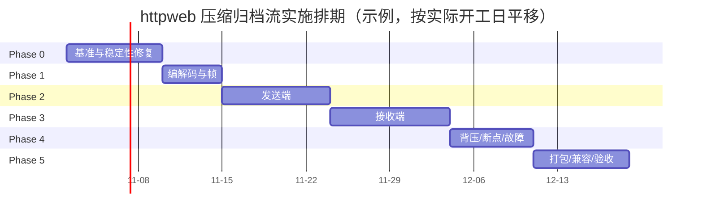

+++
id = "httpweb-compressed-stream-implementation-plan-20261029"
title = "httpweb 压缩归档流实施计划"
status = "draft"
doc_version = "0.1"
audience = ["developers"]
last_updated = "2026-10-29"
tags = ["httpweb", "transfer", "implementation", "zstd", "zlib", "plan"]
related_docs = [
    "docs/design/httpweb-compressed-stream-research.md",
    "docs/design/httpweb-compressed-stream-handoff.md"
]
+++

# httpweb 压缩归档流实施计划

> 依据：[httpweb 大目录小文件传输优化技术调研报告](httpweb-compressed-stream-research.md)。
> 交接协议：[httpweb-compressed-stream-handoff.md](httpweb-compressed-stream-handoff.md)。
> 本文是任务分解和验收依据；技术原理、协议字段和线程模型以调研报告第 3–4 章为准。

## 1. 目标与范围

### 1.1 目标

实现 DTP2 压缩归档流，替换数据迁移场景下逐文件 `info`/`download` 的传输形态：

- 每个顶层选择项一条 HTTPS 响应，发送端边遍历、边帧编码、边压缩、边发送。
- 接收端边接收、边解压、边解析、边写盘；有界队列和 `PauseReceive`/`ResumeReceive` 形成背压。
- 保留 `FileServer`/`FileClient` 公开 API、JWT/RPC 格式、进度回调和旧 HTTP 端点。
- 新版默认依赖并使用 zstd；deflate 永久保留为协议基线和回退；旧端走 legacy。
- 修复现有路径中的僵死、数据损坏、静默失败和并发竞争问题。

### 1.2 交付范围

| 模块 | 交付内容 |
|---|---|
| `src/lib/common/httpweb` | 帧编解码、发送端生产者、接收端消费者、断点、能力协商、stream 端点 |
| `src/infrastructure/netutil` | `PauseReceive`/`ResumeReceive`、发送缓冲排空/关闭、HTTP 流式 body 保护、发送统计原子化 |
| `src/lib/common/manager` | `TransferWorker` 并发修复、错误传播、进度语义 |
| 构建/打包 | zlib 链接、zstd 新增强依赖、Linux/Windows/Android 打包 |
| 测试 | 单元、集成、故障注入、兼容矩阵、100k/1M/10GB 基准 |
| 文档 | 调研报告第 5/6 章、实施计划、交接协议、发布说明 |

### 1.3 非目标

- 不重构数据迁移 UI，不改变 `TransferHelper`/`NetworkUtil` 的业务接口。
- 不改变 JWT 签名算法、TLS 配置、RPC 协议。
- 不在 v1 做文件内偏移续传（v2 再做）。
- 不在 v1 保留 ACL/xattr/硬链接/稀疏文件语义；mode/mtime 可选。
- 不把 tar/zip 作为传输格式。

### 1.4 成功标准

1. 新旧四种组合都能工作：旧↔旧、旧→新、新→旧、新↔新。
2. 新↔新默认 zstd；对端仅 deflate 时自动降级；旧端自动 legacy。
3. 100k 小文件不再出现 >10 秒无数据停顿，停止按钮 1 秒内生效。
4. 断网后可续传；最终逐文件哈希一致；不产生空文件、截断文件或 `(1)` 重复目录。
5. 接收端额外内存有上限；IO 线程不做磁盘 I/O。
6. Linux/Windows/Android 都能构建；zstd 依赖随包发布。

## 2. 已冻结决策（Decision Log）

| ID | 决策 | 状态 |
|---|---|---|
| D1 | 采用单连接、自描述帧、整流传压缩的 DTP2 归档流 | 冻结 |
| D2 | 能力协商：JWT `dtp` claim 声明版本和 codec 列表；接收端在 stream 请求中指定 codec | 冻结 |
| D3 | deflate 永久作为协议基线；新版默认依赖并默认使用 zstd（优先静态链接） | 冻结 |
| D4 | 旧端走 legacy；新服务端保留 `info`/`download` 端点 | 冻结 |
| D5 | v1 使用 `Connection: close`；chunked 作为 v2 选项 | 冻结 |
| D6 | v1 断点以整文件为粒度；v2 再做文件内偏移 | 冻结 |
| D7 | 公开 API 不变；stream 只作为内部实现路径 | 冻结 |
| D8 | IO 线程只做收发；遍历/压缩/解压/写盘在生产者/消费者线程 | 冻结 |
| D9 | 每文件 CRC32 trailer + END `streamCRC` + `.part` 原子改名 | 冻结 |
| D10 | 通过环境变量/特性开关可强制 legacy 或指定 codec/level | 冻结 |

**变更规则：** 任何 D1–D10 的修改都必须同时更新本计划、调研报告和交接协议，并在 Decision Log 记录原因；未记录的口头变更不生效。

## 3. 总体实施策略

1. **小步落地，始终保持可构建。** 每个任务结束都要求目标测试通过；不能把树留在编译失败状态。
2. **先修稳定性，再接入新协议。** Phase 0 先消除僵死、数据竞争和错误静默；否则 stream 测试会被旧问题干扰。
3. **先打通 deflate，再启用 zstd 默认。** deflate 是必须存在的回退路径；zstd 默认在打包和兼容测试通过后打开。
4. **legacy 默认保持到 M4。** 通过 `DDE_COOPERATION_TRANSFER_STREAM` 控制；新路径测试稳定后再默认开启。
5. **测试先行。** 编解码、帧、路径映射先写单测，再接网络；集成测试用本地 loopback，不依赖真实设备。
6. **打包与代码同步。** zstd 是硬依赖的决策要求 Phase 5 与代码同期完成，不能留到发布前。

## 4. 工作分解结构（WBS）

### 4.1 Phase 0：基准与稳定性修复

目标：拿到 legacy 基线，消除会干扰后续测试的僵死/竞争/静默失败。

| ID | 任务 | 关键文件 | 依赖 | 验收 | 人日 |
|---|---|---|---|---|---|
| P0-1 | 基准工具与数据集生成器 | `tests/benchmarks/*`、`tests/benchmarks/CMakeLists.txt` | 无 | 可生成 100k×4KB、1M×1KB、10GB 数据集；可跑 legacy 并输出耗时/CPU/RSS/请求数 | 1.5 |
| P0-2 | 并发与生命周期修复 | `transferworker.h/.cpp`、`syncstatus.h`、`fileclient.cpp` | 无 | `_canceled` atomic；`_status` mutex/快照；`_callback` 加锁；`HTTPFileClient::_canceled` 每请求重置 | 1 |
| P0-3 | 超时/重连/请求隔离 | `fileclient.cpp`、`https_client.cpp` | P0-2 | 超时后先断开并等待，再发下一请求；旧响应不能完成新 promise；无跨文件错位 | 1 |
| P0-4 | 服务端健壮性 | `fileserver.cpp` | 无 | `offset <= size` 校验；`stoll` 捕获；`webBind` 失败使传输失败；`requestInfo` 有成功标志；`downloadFile` 返回真实结果 | 1 |
| P0-5 | HTTP body 正确性 | `http_response.h/.cpp`、`fileclient.cpp` | 无 | header+body 同包不丢数据；`X-DTP-Stream` 时禁用 CRLFCRLF 启发式；单测覆盖 | 1 |
| P0-6 | 符号链接环检测 | `filesizecounter.cpp`、`fileclient.cpp` | 无 | 符号链接环 2 秒内终止；深目录不爆栈 | 0.5 |
| P0-7 | legacy 基线记录 | 交接协议/实验记录 | P0-1..P0-6 | 100k 场景有完整基线；失败/停顿有记录 | 0.5 |

**Phase 0 实现要点：**

- 基准工具必须带超时；legacy 在 100k 文件上可能很慢，先跑 1k/10k 预热，再跑 100k。
- 并发修复不要改变公开回调语义；`TransferWorker` 仍通过 Qt queued signal 通知 UI。
- 超时后必须 `DisconnectAsync` 并等待连接结束；不要复用可能仍有旧响应的连接。
- `requestInfo` 增加 `bool ok`/`std::optional<InfoEntry>`；失败不能等价于空文件。
- header/body 修复要同时覆盖 legacy 和未来的 stream 路径；单元测试构造一个包含 header+body 的 buffer。
- 符号链接检测用 `(dev, inode)` 或 `weakly_canonical`；不要只比较路径字符串。

**Phase 0 出口条件：** 目标单测通过；100k legacy 基准可重复运行；已知僵死路径有回归测试或明确记录。

### 4.2 Phase 1：编解码与帧

目标：把协议核心做成可独立测试的库，不碰网络。

| ID | 任务 | 关键文件 | 依赖 | 验收 | 人日 |
|---|---|---|---|---|---|
| P1-1 | `StreamCodec`：deflate/zstd/none 流式编解码 | `src/lib/common/httpweb/streamcodec.h/.cpp` | 无 | 支持分块 feed、flush、finish；空输入/大输入/单字节输入正确；错误可返回 | 1.5 |
| P1-2 | `StreamFrame`：帧编码/解码、CRC、END | `streamframe.h/.cpp` | P1-1 | 帧头小端；pathLen/size 上限；CRC trailer；END 校验；未知类型报错 | 1.5 |
| P1-3 | 单元测试：编解码/帧/截断/损坏 | `tests/logic/httpweb_stream_*_test.cpp` | P1-1/P1-2 | 每个字节截断、CRC 翻转、超长 path、零字节文件、Unicode、路径穿越都覆盖 | 1.5 |
| P1-4 | CMake：zlib 必选、zstd 可选 | `src/lib/common/httpweb/CMakeLists.txt` | P1-1 | `ZLIB::ZLIB` 链接；`HTTPWEB_HAVE_ZSTD` 宏；测试目标可链接 | 0.5 |
| P1-5 | 内部接口注释/文档 | 新头文件 | P1-1..P1-3 | 类职责、线程约束、错误语义清楚 | 0.5 |

**Phase 1 实现要点：**

- `StreamEncoder`/`StreamDecoder` 是纯流式接口，不持有 socket、不写文件；输出通过回调或 `std::string` buffer 返回。
- zlib 使用 `deflateInit2`/`inflateInit2`；每文件 `Z_SYNC_FLUSH`，流结束 `Z_FINISH`。
- zstd 使用 `ZSTD_compressStream2`/`ZSTD_decompressStream`；只使用标准 frame，不启用实验特性/字典。
- 帧解析必须支持“一个输入块包含多个帧”和“一个帧跨多个输入块”两种边界。
- 帧头/数据/CRC 的边界不能靠“读到 EOF”判断；必须按 `size` 精确读取。
- 所有长度字段先做上限检查再分配内存，避免恶意帧导致 OOM。

**Phase 1 出口条件：** 编解码/帧单测全绿；截断/损坏/路径穿越测试全绿；可在内存中往返 100k 个小文件帧。

### 4.3 Phase 2：发送端

目标：服务端能把一个目录编码成 DTP2 流并异步发出，不阻塞 IO 线程。

| ID | 任务 | 关键文件 | 依赖 | 验收 | 人日 |
|---|---|---|---|---|---|
| P2-1 | `StreamWalker`：确定性遍历 | `streamwalker.h/.cpp`（可并入 producer） | P1-2 | 每层排序；空目录；特殊文件跳过/报错；符号链接环检测；相对路径 | 1.5 |
| P2-2 | `StreamProducer`：读盘/编码/压缩/队列 | `streamproducer.h/.cpp` | P2-1/P1-1 | 生产者线程；有界队列；64–256KB 读；每文件 flush；取消可退出 | 2 |
| P2-3 | `FileServer::serveStream` 端点 | `fileserver.cpp` | P2-2 | 解析 name/token/codec/from/off；校验绑定路径；发送正确响应头；无 Content-Length | 1.5 |
| P2-4 | 异步发送与背压 | `tcp_session.h/.cpp`、`fileserver.cpp` | P2-3 | `SendResponseBodyAsync`；send buffer 上限；高水位等待；END 后排空再关闭 | 1.5 |
| P2-5 | 进度/取消/错误映射 | `streamproducer.cpp`、`fileserver.cpp` | P2-2 | `RES_OKHEADER/RES_BODY/RES_FINISH` 或 `WEB_*` 回调正确；停止可 join | 1 |
| P2-6 | 发送端集成测试 | `tests/logic/httpweb_stream_sender_test.cpp` | P2-1..P2-5 | 本地测试客户端能读到 preamble/帧/END；目录树/空目录/大文件通过 | 1 |

**Phase 2 实现要点：**

- 遍历顺序必须与断点重放一致：每层目录项按原始字节排序；不要依赖 `directory_iterator` 顺序。
- 生产者线程只读盘/编码/压缩；不直接操作 socket。
- IO 线程只调用异步发送；发送缓冲高水位时生产者等待，不要在 IO 线程上 `sleep` 或同步写。
- `END` 入队不等于已发送；必须等 `bytes_pending()==0` 或 `onEmpty` 后再 `Disconnect`。
- `bytes_pending()` 改为 atomic 或加锁；生产者跨线程读取。
- 每个文件结束 `Z_SYNC_FLUSH`，让接收端及时完成；流结束 `Z_FINISH`。
- 错误帧/中止时也要正确结束 HTTP 响应；不能让客户端无限等待。

**Phase 2 出口条件：** 本地客户端能完整解析一条 stream；发送 100k 文件不阻塞 IO 线程；停止/对端断开后生产者线程能退出。

### 4.4 Phase 3：接收端

目标：接收端边收边解压边还原，并保持现有保存路径语义。

| ID | 任务 | 关键文件 | 依赖 | 验收 | 人日 |
|---|---|---|---|---|---|
| P3-1 | token 能力协商 | `tokencache.h/.cpp`、`fileclient.cpp` | P1-2 | `dtp` claim 解析；无 claim 走 legacy；codec 交集选择 | 1 |
| P3-2 | `StreamConsumer`：解压/解析/状态机 | `streamconsumer.h/.cpp` | P1-1/P1-2 | 队列消费；inflate；帧状态机；跨块边界正确 | 1.5 |
| P3-3 | 路径映射/冲突/安全 | `fileclient.cpp`、`streamconsumer.cpp` | P3-2 | 根目录只创建一次；相对路径；`..`/绝对路径拒绝；重名 `(1)`；长文件名 | 1.5 |
| P3-4 | `.part` 写入/CRC/rename | `streamconsumer.cpp`、`fileclient.cpp` | P3-2 | 边写边算 CRC；trailer 校验；成功后 rename；失败不留最终文件 | 1 |
| P3-5 | 进度/错误/legacy 回退 | `fileclient.cpp`、`transferworker.cpp` | P3-1..P3-4 | `WEB_*` 语义正确；失败不发 FINISH；stream 404/501 在写盘前回退 | 1 |
| P3-6 | 接收端集成测试 | `tests/logic/httpweb_stream_receiver_test.cpp` | P3-1..P3-5 | 10k 文件树哈希一致；空文件/空目录/Unicode/长名通过 | 1.5 |
| P3-7 | 内部接口注释/文档 | 新头文件 | P3-1..P3-6 | 线程/错误/路径约束清楚 | 0.5 |

**Phase 3 实现要点：**

- 接收端 IO 线程只入队；解压、解析、写盘都在下载/消费线程。
- 队列高水位调用 `PauseReceive`，低水位 `ResumeReceive`；不要让 IO 线程阻塞在磁盘上。
- 根目录只调用一次 `createNextAvailableName`，子项用相对路径拼接；避免每个文件重复根重命名。
- 文件写 `.part`，校验 size+CRC 后 `rename`；空文件也走同一流程。
- 路径校验：`lexically_normal` 后必须在根目录内；拒绝绝对路径、`..`、NUL；Windows 非法字符单独处理。
- 回退只允许在“尚未写入任何文件”时发生；已经写入后只能 retry/resume，不能混用 legacy。
- 错误要带具体文件/阶段，避免只报 “io_error”。

**Phase 3 出口条件：** 本地 sender→receiver 端到端还原树，逐文件哈希一致；legacy 回退可用；安全测试通过。

### 4.5 Phase 4：背压、断点、故障注入

目标：把“能传”变成“网络抖动/慢盘/停止时不僵死、可恢复”。

| ID | 任务 | 关键文件 | 依赖 | 验收 | 人日 |
|---|---|---|---|---|---|
| P4-1 | `PauseReceive`/`ResumeReceive` | `tcp_session.h/.cpp` | P3-2 | 高水位暂停、低水位恢复；无 busy loop；线程安全 | 1.5 |
| P4-2 | 发送缓冲排空/关闭 | `tcp_session.h/.cpp`、`fileserver.cpp` | P2-4 | END 后数据完整到达；关闭不截断；关闭有超时 | 1 |
| P4-3 | checkpoint/from/off | `transfercheckpoint.h/.cpp`、`fileclient.cpp` | P3-3 | 每文件更新；重连跳过已完成；成功后删除；损坏 checkpoint 可回退 | 1.5 |
| P4-4 | watchdog/重试/错误分类 | `fileclient.cpp`、`streamconsumer.cpp` | P4-1/P4-3 | 空闲超时；指数退避；网络/磁盘/协议错误区分；最大重试 | 1 |
| P4-5 | 故障注入测试 | `tests/logic/httpweb_stream_fault_test.cpp` | P4-1..P4-4 | 断网、慢消费者、磁盘满、源文件删除、停止均不 hang；哈希一致 | 1 |

**Phase 4 实现要点：**

- `PauseReceive` 只影响“下一次 re-arm”，不能取消已经在途的 read；恢复时 post 到 io_service/strand。
- 关闭前必须排空 `_send_buffer_main` 和 `_send_buffer_flush`；`Disconnect` 不能在仍有待发数据时调用。
- checkpoint 用临时文件+原子 rename；记录 tokenHash/rootName/frameIndex/offset/size/mtime。
- 重放顺序必须与 P2-1 一致；源文件 size/mtime 变化时当前文件重传或报错，不能静默拼接。
- watchdog 在消费线程/下载线程，不在 IO 线程；超时后主动断开并进入重试。
- 停止路径：取消标志 → 断开网络 → 唤醒队列 → join；每个等待都要能被取消唤醒。

**Phase 4 出口条件：** 断网后续传成功；停止 <1 秒；慢盘时内存有界；故障测试无 hang/无最终残缺文件。

### 4.6 Phase 5：打包、兼容、验收

目标：把 zstd 默认依赖和跨平台发布做实，完成 A/B 与兼容矩阵。

| ID | 任务 | 关键文件 | 依赖 | 验收 | 人日 |
|---|---|---|---|---|---|
| P5-1 | zstd 静态链接/打包 | CMake、`vcpkg.json.in`、`clean_build.bat`、`prepare_dependencies.bat`、`debian/control`、Android CMake | P1-4 | Linux/Windows/Android 构建通过；新包默认 zstd；无系统 zstd 也能运行（静态） | 2 |
| P5-2 | 新旧兼容矩阵 | 测试脚本/人工 | P3-5/P5-1 | 旧↔旧、旧→新、新→旧、新↔新；zstd/deflate 组合全通过 | 1 |
| P5-3 | 性能验收 | benchmark、实验记录 | P4-5 | 100k/1M/10GB 数据；记录时间/CPU/RSS/syscall/停顿；与基线对比 | 1 |
| P5-4 | 灰度/开关/回滚 | `transferworker.cpp`、文档 | P3-5 | 环境变量强制 legacy；异常自动回退策略；日志可定位 | 0.5 |
| P5-5 | 文档收尾 | 调研报告第 5/6 章、交接协议、发布说明 | 全部 | 实施/实验章节补齐；交接状态更新 | 1 |

**Phase 5 实现要点：**

- Linux：`find_package(zstd CONFIG QUIET)` 或 `pkg_check_modules`；优先静态库；`debian/control` 加 `libzstd-dev`（Build-Depends）；动态链接时由 `${shlibs:Depends}` 带 `libzstd1`。
- Windows：vcpkg 加 zstd，使用静态三元组；安装包不需要额外 DLL；如果动态，安装包必须带 DLL。
- Android：按 ABI 链接 libzstd；如果 NDK 没有预编译包，使用项目统一的 third-party 预编译方式或 vendored 源码。
- 新版本默认 zstd，但必须保留 deflate 回退；兼容矩阵是发布门槛。
- 性能验收不要只看总时间；要区分网络时间、CPU 时间、磁盘时间，否则会把磁盘瓶颈误判为协议问题。

**Phase 5 出口条件：** 三种平台构建通过；兼容矩阵全通过；100k 基准达到约定目标；文档/交接完成。

## 5. 里程碑与排期

| 里程碑 | 内容 | 出口 |
|---|---|---|
| M0 | 调研、设计、实施计划、交接协议 | 本次完成 |
| M1 | Phase 0 完成 | 基线数据 + 稳定性回归 |
| M2 | Phase 1 完成 | 编解码/帧单测全绿 |
| M3 | Phase 2 完成 | 发送端可独立流出完整归档 |
| M4 | Phase 3 完成 | 本地端到端还原，哈希一致 |
| M5 | Phase 4 完成 | 断点/背压/故障注入通过 |
| M6 | Phase 5 完成 | 三平台构建 + 兼容矩阵 + 100k 验收 |
| M7 | 发布候选 | 灰度/回滚演练完成 |



**估算（1 名熟悉 C++/Qt/Asio 的工程师）：**

| 阶段 | 人日 |
|---|---|
| Phase 0 | 6–8 |
| Phase 1 | 4–5 |
| Phase 2 | 7–9 |
| Phase 3 | 8–10 |
| Phase 4 | 6–7 |
| Phase 5 | 6–8 |
| 合计 | 37–47 人日 |

- MVP（Phase 0–3）：约 25–32 人日，日历时间约 5–7 周。
- 完整稳定版（Phase 0–5）：约 7–9 周。
- Windows/Android 实机验证、产品验收等待不计入；如果并行投入第二人做打包/跨平台，日历时间可缩短。

## 6. 测试与验收

### 6.1 测试分层

| 层级 | 工具 | 覆盖 |
|---|---|---|
| 单元 | GTest（`tests/logic`） | codec、帧、路径、checkpoint、token 能力 |
| 集成 | GTest + 本地 loopback | sender→receiver 端到端、legacy 回退、兼容矩阵 |
| 故障注入 | GTest/本地代理 | 断网、慢盘、磁盘满、源文件删除、停止 |
| 性能 | 独立 benchmark | 100k/1M/10GB、CPU/RSS/syscall/停顿 |
| 安全 | GTest | 路径穿越、绝对路径、NUL、超长/超大帧、CRC 损坏 |

### 6.2 构建与运行命令

当前开发机只有 Qt5（`/usr/lib/x86_64-linux-gnu/cmake/Qt5`），不要直接用强制 Qt6 的 `test-prj-running.sh` 作为日常门禁。

```bash
# 配置（Qt5 自动选择；Qt6 环境请额外加 CMAKE_PREFIX_PATH）
cmake -S . -B build-dev \
  -DCMAKE_BUILD_TYPE=Debug \
  -DDOTEST=ON

# 编译目标测试（先全量编译一次，确保依赖生成）
cmake --build build-dev -j"$(nproc)"

# 找到并运行逻辑测试
TEST_BIN="$(find build-dev -type f -executable -name lib_logic_tests | head -1)"
"$TEST_BIN" --gtest_list_tests
"$TEST_BIN" --gtest_filter='HttpWebStream*'
```

如果 CTest 已启用，可用：

```bash
ctest --test-dir build-dev -R 'lib_logic_tests|netutil_http_tests' --output-on-failure
```

netutil 的 Catch2 测试需要 `-DBUILD_NETUTIL_TESTS=ON`，部分用例可能挂起；使用 `timeout`，只把 `netutil_http_tests` 作为 HTTP 解析门禁。

基准工具（Phase 0 新增）：

```bash
cmake -S . -B build-bench \
  -DCMAKE_BUILD_TYPE=Release \
  -DBUILD_HTTPWEB_BENCH=ON
cmake --build build-bench -j"$(nproc)" --target httpweb_transfer_benchmark

./build-bench/tests/benchmarks/httpweb_transfer_benchmark \
  --generate /tmp/dtp-bench-100k --files 100000 --size 4096
./build-bench/tests/benchmarks/httpweb_transfer_benchmark \
  --legacy --src /tmp/dtp-bench-100k --dst /tmp/dtp-bench-out --timeout 600
```

> 具体参数以 P0-1 实现为准；本节先固定命令形状，避免下一会话重复设计。

### 6.3 数据集

| 数据集 | 用途 | 生成方式 |
|---|---|---|
| 100k × 4KB | 主验收场景 | benchmark `--files 100000 --size 4096` |
| 1M × 1KB | 元数据/内存压力 | benchmark `--files 1000000 --size 1024` |
| 10GB 单文件 | 大文件吞吐 | `fallocate`/benchmark `--single 10G` |
| 混合树 | 真实迁移 | 文本/图片/视频/空文件/空目录/深目录/Unicode/长名/符号链接 |
| 损坏流 | 帧/CRC 测试 | 单测直接构造，不依赖磁盘 |

### 6.4 各阶段验收门禁

| 阶段 | 必须通过 |
|---|---|
| Phase 0 | 目标单测；legacy 基准可重复；header/body 同包测试；符号链接环测试 |
| Phase 1 | codec/帧单测全绿；每个字节截断；CRC 损坏；路径穿越 |
| Phase 2 | 发送端流出完整 END；100k 不阻塞 IO 线程；停止/断开可退出 |
| Phase 3 | 端到端哈希一致；空文件/空目录；legacy 回退；安全测试 |
| Phase 4 | 断网续传；慢盘内存有界；停止 <1s；无残缺最终文件 |
| Phase 5 | 三平台构建；兼容矩阵；100k 性能；打包无缺失 |

### 6.5 性能指标

- 墙钟时间：legacy vs stream。
- CPU：user/sys；压缩/解压占比。
- RSS 峰值；队列/发送缓冲深度。
- syscall 数（`strace -c`）；HTTP 请求数。
- 无数据停顿次数/最长停顿。
- 失败/重试次数；哈希一致性。
- 磁盘时间 vs 网络时间拆分（至少用不同磁盘/网络条件对比）。

### 6.6 兼容矩阵

| 发送端 | 接收端 | 期望 |
|---|---|---|
| 旧 | 旧 | legacy |
| 旧 | 新 | legacy（token 无 `dtp`） |
| 新 | 旧 | legacy（旧端不调用 stream；新服务端保留旧端点） |
| 新 | 新，均支持 zstd | zstd |
| 新 | 新，仅 deflate | deflate |
| 新 | 新，强制 legacy 开关 | legacy |

### 6.7 故障注入

- 传输中断：在 N% 处断开；重连续传；最终哈希一致。
- 慢消费者：限制消费线程/磁盘速度；队列不无限增长；TCP 背压生效。
- 磁盘满：返回 `WEB_IO_ERROR`，不重试；不留最终残缺文件。
- 源文件删除/缩短：发 ERROR/中止；UI 能定位文件。
- 停止：1 秒内退出；发送端/接收端都不 hang。
- 对端不发 END 直接断开：接收端判定失败，不 rename。

### 6.8 安全测试

- 帧 path 为绝对路径、含 `..`、含 NUL、超长。
- 单文件 size 超过剩余磁盘/上限；总大小异常。
- CRC 错误、END 缺失、未知帧类型。
- 服务端 `getPath` 前缀碰撞（`/foo` vs `/foobar`）、符号链接越界。
- 畸形 token/JWT；`offset > size`；`stoll` 溢出。

## 7. 交付物清单

### 7.1 新增源码

| 文件 | 作用 |
|---|---|
| `src/lib/common/httpweb/streamcodec.h/.cpp` | zlib/zstd/none 流式编解码 |
| `src/lib/common/httpweb/streamframe.h/.cpp` | 帧编码/解码、CRC、END |
| `src/lib/common/httpweb/streamwalker.h/.cpp` | 确定性遍历（可并入 producer） |
| `src/lib/common/httpweb/streamproducer.h/.cpp` | 发送端生产者/队列 |
| `src/lib/common/httpweb/streamconsumer.h/.cpp` | 接收端消费者/状态机 |
| `src/lib/common/httpweb/transfercheckpoint.h/.cpp` | 断点读写 |
| `tests/logic/httpweb_stream_*_test.cpp` | 单元/集成/故障/安全测试 |
| `tests/benchmarks/httpweb_transfer_benchmark.cpp` | 基准工具/数据生成 |
| `tests/benchmarks/CMakeLists.txt` | benchmark 目标 |

### 7.2 修改文件

| 文件 | 修改 |
|---|---|
| `src/lib/common/httpweb/fileclient.h/.cpp` | capability、stream 下载、回退、进度、checkpoint |
| `src/lib/common/httpweb/fileserver.cpp` | `serveStream`、响应头、start producer、错误处理 |
| `src/lib/common/httpweb/tokencache.h/.cpp` | `dtp` claim |
| `src/lib/common/httpweb/CMakeLists.txt` | zlib/zstd 链接 |
| `src/infrastructure/netutil/include/asio/tcp_session.h` | Pause/Resume、send drain、atomic stats |
| `src/infrastructure/netutil/src/asio/tcp_session.cpp` | 上述实现 |
| `src/infrastructure/netutil/include/http/http_response.h` | stream 模式标志 |
| `src/infrastructure/netutil/src/http/http_response.cpp` | CRLFCRLF 启发式保护、header/body 修复 |
| `src/lib/common/manager/transferworker.h/.cpp` | 并发修复、错误传播 |
| `tests/CMakeLists.txt` | 添加 benchmarks 子目录（可选开关） |
| `debian/control` | `libzstd-dev` |
| `vcpkg.json.in` / `clean_build.bat` / `prepare_dependencies.bat` | Windows zstd |
| Android CMake | zstd 链接/预编译 |

### 7.3 文档

- 调研报告第 5 章（指向本计划）和第 6 章（实验数据）。
- 本实施计划（任务状态/变更）。
- 交接协议（每个会话更新）。
- 发布说明/回滚说明。

## 8. 风险与应对

| 风险 | 影响 | 应对 |
|---|---|---|
| zstd 在 Windows/Android 打包失败 | 新版默认 codec 不可用 | 提前做 Phase 5 P5-1；静态链接；失败时 deflate 回退并记录 |
| netutil 改动影响其他业务 | 回归 | 只加 opt-in 方法；默认行为不变；netutil_http_tests + 集成测试 |
| `Connection: close` 被中间层缓冲 | 首字节延迟/flow 中断 | 直连/隧道场景先验证；v2 上 chunked |
| 慢盘导致内存增长 | OOM | 有界队列 + PauseReceive；高/低水位测试 |
| 断点重放顺序不稳定 | 续传错位 | 每层排序；size/mtime 校验；v1 整文件粒度 |
| 路径/符号链接安全 | 越权写入 | 相对路径校验、canonical containment、环检测、安全测试 |
| 现有测试基础设施不稳定 | 误判 | 用定向 GTest；`test-prj-running.sh` 不作为门禁；记录已知失败 |
| 范围蔓延 | 延期 | 非目标明确；v1 不做文件内续传/ACL/xattr/硬链接 |

## 9. Definition of Done

- [ ] `FileServer`/`FileClient` 公开 API 未变；旧端点可用。
- [ ] 新↔新默认 zstd；仅 deflate 对端自动降级；旧端 legacy。
- [ ] 100k 小文件端到端哈希一致；无 >10 秒无数据停顿。
- [ ] 停止 <1 秒；断网可续传；无最终残缺文件。
- [ ] 接收端内存有界；IO 线程不做磁盘 I/O。
- [ ] 编解码/帧/路径/安全/故障测试全绿。
- [ ] Linux/Windows/Android 构建通过；zstd 随包发布。
- [ ] 100k/1M/10GB 基准完成，数据写入调研报告第 6 章。
- [ ] 交接协议更新到最终状态；发布/回滚说明完成。

## 10. 变更控制

1. 任何协议/决策变更：先更新 Decision Log，再改代码；同步更新调研报告和交接协议。
2. 新增任务：在 WBS 中加 ID，不插入未编号工作。
3. 任务完成：更新交接协议状态表；记录测试命令和结果。
4. 任务取消：记录原因和替代方案，不能静默删除。
5. 发布前：以 Definition of Done 为唯一门禁，不以“本地能跑”代替。
