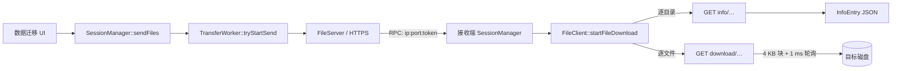
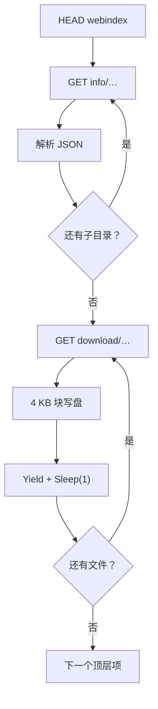
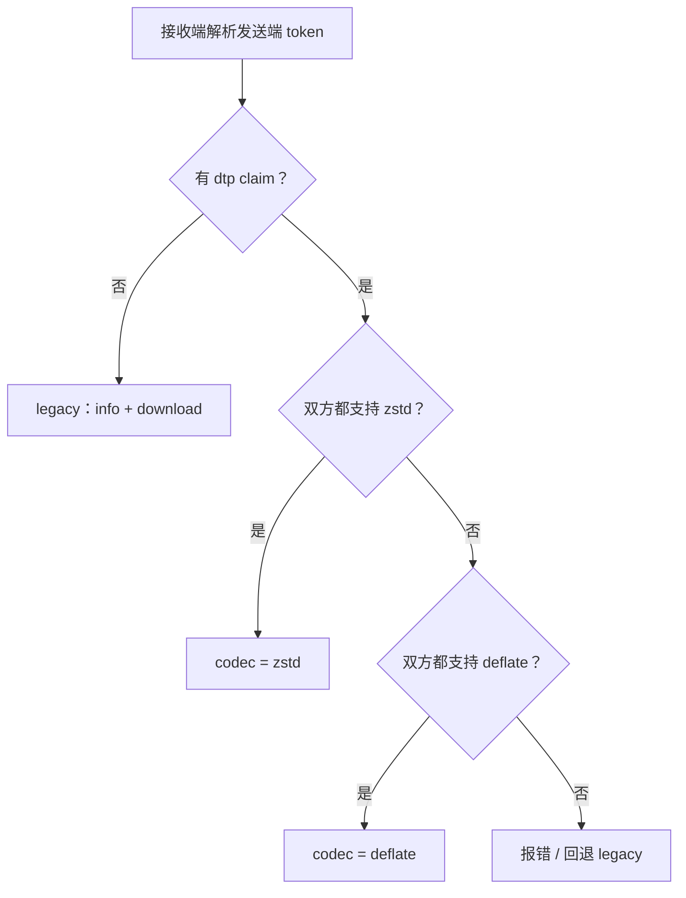
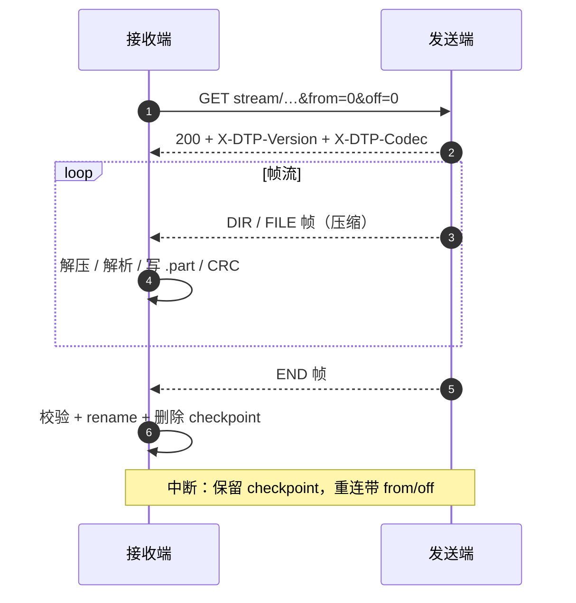
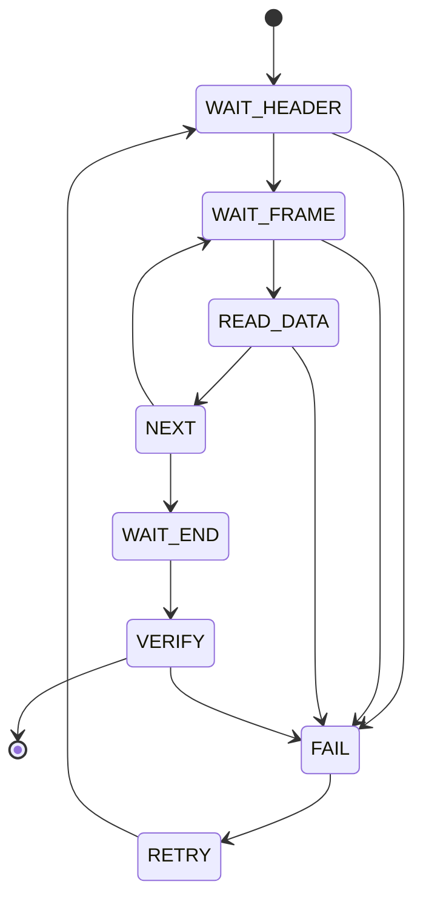

+++
id = "httpweb-compressed-stream-research-20261029"
title = "httpweb 大目录小文件传输优化技术调研报告"
status = "draft"
doc_version = "0.3"
audience = ["developers", "architects"]
last_updated = "2026-10-29"
tags = ["httpweb", "transfer", "compression", "zstd", "zlib", "design"]
related_docs = [
    "docs/architecture.md",
    "docs/features/transfer.md",
    "docs/design/httpweb-compressed-stream-implementation-plan.md",
    "docs/design/httpweb-compressed-stream-handoff.md"
]
+++

# httpweb 大目录小文件传输优化技术调研报告

> 调研对象：`src/lib/common/httpweb` 及其依赖的 `src/infrastructure/netutil` HTTP/Asio 栈。
> 代码基线：`v20-trans` 分支（2026-10-29）。
> 说明：本文只做调研与方案设计，未修改业务代码。第 5 章“实施”和第 6 章“实验验证”按要求留空，后续补充。

## 1. 问题

### 1.1 背景

数据迁移应用通过 `httpweb` 在两台设备之间传输用户选择的文件或目录。发送端把顶层选择项绑定到 HTTP 服务，接收端用 JWT token 获取绑定列表，然后逐个目录请求元数据、逐个文件下载并写盘。

当用户选择一个包含几十万个小文件的目录时，传输会明显变慢，甚至长时间没有进度或无法停止。现场表现为：

- 文件数越多，总耗时越接近“文件数 × 固定时间”，而不是“总字节数 / 带宽”。
- 进度长时间停在同一文件或同一目录。
- 点击停止后，发送端或接收端仍占用线程/端口，进程无法正常退出。
- 网络抖动或接收端磁盘变慢时，发送端可能永久阻塞。
- 个别文件传输失败后，整体仍可能显示“完成”，但目标目录缺少文件或出现空文件。

### 1.2 目标

本调研要回答三个问题：

1. `httpweb` 当前是如何组织和传输文件的，瓶颈具体在哪里。
2. 能否改成“发送端边压缩边传、接收端边接收边解压还原”的压缩流，同时尽量保持接口兼容。
3. 跨平台压缩库（zlib/zstd）如何选择，UOS 有 zstd、Windows 没有时两端能否互通，是否应该强依赖 zstd。

### 1.3 范围与不变量

**范围内：**

- `httpweb` 的协议、线程模型、文件遍历、下载/保存逻辑。
- `netutil` 中与 HTTP 响应流式收发、Asio session 发送缓冲相关的部分。
- `TransferWorker` / `SessionManager` 与 `httpweb` 的衔接方式。
- 新协议的服务端和客户端实现方案。

**不变量（必须保持）：**

- `FileServer` / `FileClient` 的公开方法签名不变。
- `TransferWorker`、`SessionManager`、数据迁移 UI 不需要改调用方式。
- JWT token、RPC endpoint 格式、进度回调接口保持兼容。
- 旧的 `info` / `download` HTTP 端点继续可用，旧版本接收端仍能工作。
- TLS、鉴权、路径安全策略不被削弱。

### 1.4 术语

| 术语 | 含义 |
|---|---|
| legacy 路径 | 现有的 `info` + `download` 逐文件协议 |
| stream 路径 | 本文建议的单连接归档流协议 |
| 帧（frame） | 归档流中的一个自描述单元，例如 DIR、FILE、END |
| 顶层选择项 | 用户在发送端选择的一个文件或目录 |
| 压缩流 | 整条帧流经过 deflate/zstd 压缩后的字节流 |
| 断点 checkpoint | 接收端记录的已完成帧/偏移，用于重连续传 |

### 1.5 五个视角的图表索引

| 视角 | 图表 | 位置 |
|---|---|---|
| 现状链路 | 图 1 调用链、图 2 逐文件循环 | 2.2、2.3 |
| 目标架构 | 图 3 发送/接收流水线 | 4.2 |
| 协议帧 | 图 4 分层、帧字段表 | 4.3 |
| 兼容与协商 | 图 5 codec 协商决策、兼容矩阵 | 4.4、4.9 |
| 时序与恢复 | 图 6 正常时序、图 7 状态机 | 4.8 |

> 图表采用 Mermaid 文本描述，便于版本管理和代码评审；在 GitHub/GitLab、VS Code（安装 Mermaid 插件）等渲染器中可直接查看。帧字段采用等宽代码块 + 表格，避免位图在深浅主题下失真。

## 2. 现状

### 2.1 代码结构

| 文件 | 职责 | 关键点 |
|---|---|---|
| `src/lib/common/httpweb/webproto.h` | `InfoEntry` JSON 协议 | 目录 `size=-1`，文件 `size>=0`；空文件和请求失败都表现为 `0` |
| `src/lib/common/httpweb/fileserver.cpp` | HTTPS 服务端 | `webBind` 绑定虚拟名到磁盘路径；`serveInfo` 只列一层目录；`serveContent` 4 KB 块同步发送 |
| `src/lib/common/httpweb/fileclient.cpp` | HTTPS 客户端 | `requestInfo` 逐目录取 JSON；`walkFolder` 递归遍历；`downloadFile` 逐文件下载 |
| `src/lib/common/httpweb/webbinder.cpp` | 虚拟路径映射 | `getPath` 用字符串前缀拼接 |
| `src/lib/common/httpweb/tokencache.cpp` | JWT token | ES256K；`web` claim 保存本次选择的名称列表 |
| `src/lib/common/httpweb/syncstatus.h` | 状态与回调 | `WebState`、`HandleResult`、`BLOCK_SIZE=4096` |
| `src/infrastructure/netutil/*` | HTTP/Asio 基础设施 | 单 IO 线程、同步 `Send`、HTTP 响应缓存 |

### 2.2 调用链

**发送端：**

1. 数据迁移 UI 调用 `NetworkUtil::doSendFiles`。
2. `SessionManager::sendFiles` 创建 `TransferWorker`。
3. `TransferWorker::tryStartSend` 启动 `FileServer`，对每个顶层路径执行 `webBind`，并调用 `genToken` 生成 JWT。
4. 通过 RPC 把 `endpoint = ip:port:token`、`names`、`size` 发给接收端。
5. `FileSizeCounter` 在后台统计目录总大小，稍后通过 `INFO_TRANS_COUNT` 通知接收端。

**接收端：**

1. `SessionManager::handleTransData` 解析 endpoint，调用 `recvFiles`。
2. `TransferWorker::tryStartReceive` 创建 `FileClient`，调用 `setConfig(token, saveDir)`。
3. `FileClient::parseWeb` 从 token 的 `web` claim 取出顶层名称列表。
4. `FileClient::startFileDownload` 启动下载线程，执行 `walkDownload`。
5. 对每个顶层名称：`requestInfo` 判断文件/目录；目录则递归 `walkFolder` / `walkFolderEntry`；文件则 `downloadFile`。
6. 保存时调用 `createNextAvailableName` / `createNotExistPath`，处理重名、长文件名和路径穿越。



**图 1** 现状调用链：发送端绑定 → RPC → 接收端逐文件下载。

### 2.3 现有 HTTP 协议

**控制信令（HEAD）：**

- `HEAD webstart>`：整个传输开始。
- `HEAD webindex><name>`：某个顶层选择项开始。
- `HEAD webfinish>`：整个传输结束。

**数据请求（GET）：**

- `GET info/<base64(name)>&token=<jwt>`：返回当前一层的 `InfoEntry` JSON。目录的子项只列一层，客户端对每个子目录再请求一次。
- `GET download/<base64(name)>&token=<jwt>&offset=<n>`：返回文件裸字节流，`Content-Length` 为剩余大小。

**鉴权：**

- 发送端为本次选择生成 JWT，`web` claim 保存名称列表。
- 服务端校验 token 签名、issuer、过期时间。
- 请求路径经过 Base64 编码，避免文件名中的 `&` 破坏 query。

**进度：**

- 服务端 `FileServer::CreateSession` 把 `RES_OKHEADER` / `RES_BODY` / `RES_FINISH` 回调转成 `WEB_FILE_BEGIN` / `onProgress` / `WEB_FILE_END`。
- 客户端 `FileClient::downloadFile` 在 HTTP 回调里直接写盘并调用 `onProgress`。
- `TransferWorker` 把回调转成 Qt 信号，`NetworkUtil` 更新 UI。

**图 2** 逐文件循环：每个文件一次请求，每个子目录一次 info。



### 2.4 线程与 IO 模型

- 每个 `TransferWorker` 创建一个 `AsioService`，默认只有 **1 个 IO 线程**（`netutil/include/asio/service.h:57`，`Service(int threads = 1, bool pool = false)`）。
- 服务端 `serveContent` 在 IO 线程上循环：读 4 KB → `SendResponseBody` 同步 `asio::write` → 回调。
- 客户端 `downloadFile` 的 HTTP 回调也在 IO 线程上执行，包括 `tempFile.Write` 写盘。
- 客户端另有一个 `_downloadThread`，负责发起请求和 1 ms 轮询等待。
- `FileServer::stop()` 设置 `_stop` 后调用 `Stop()`；`TCPServer::Stop()` 会 `DisconnectAll()` 并 join IO 线程。

### 2.5 构建与依赖

- 项目使用 C++17（`CMakeLists.txt:5`），同时支持 Qt 5 / Qt 6（`CMakeLists.txt:106`）。
- `httpweb` 当前只链接 `netutil`，没有直接依赖 zlib。
- 项目其他部分已经依赖 zlib：`src/infrastructure/logging/CMakeLists.txt`、`src/lib/data-transfer/quazip/CMakeLists.txt:48` 都有 `find_package(ZLIB REQUIRED)`。
- 当前没有 zstd 依赖。
- 目标状态：`httpweb` 新增 zstd 依赖；新版默认静态链接/打包 zstd，同时保留 zlib 作为 deflate 基线。
- Linux、Windows、Android 都在构建范围内；Windows 使用 vcpkg，Android 使用 NDK/OpenSSL 预编译包。

### 2.6 现有兼容性设计

- 接收端通过 token 拿到顶层名称，不依赖发送端 RPC 之外的状态。
- 发送端保留 `info` / `download` 两个端点；只要这两个端点不变，旧接收端就能继续工作。
- JWT 允许附加 claim；旧版本校验时会忽略不认识的 claim。
- `FileClient` / `FileServer` 的公开接口很小，适合在内部增加新路径而不影响业务层。

## 3. 分析

### 3.1 时间模型

设：

- `N_f`：文件数；
- `N_d`：目录数；
- `RTT`：一次 HTTP 请求/响应往返；
- `T_poll`：每文件轮询等待；
- `T_fs`：每文件打开/创建/写入/关闭的系统调用成本；
- `BW`：有效带宽。

现有路径近似：

```text
T_legacy ≈ N_f × (RTT + T_poll + T_fs)
         + N_d × (RTT + T_json)
         + data / BW
```

压缩流路径近似：

```text
T_stream ≈ max(T_walk+compress, T_inflate+write, data_compressed / BW)
         + N_f × T_fs
```

关键差别不是压缩比，而是把 `N_f × RTT` 和 `N_f × T_poll` 两项从公式里拿掉。

按代码中的常量推算：

- 每文件轮询循环使用 `Yield + Sleep(1)`，100k 文件仅轮询下限就是 **100 秒**（`fileclient.cpp:18`、`fileclient.cpp:462-470`）。
- LAN RTT 0.3 ms 时，100k 次往返再加约 30 秒；Wi-Fi RTT 3 ms 时再加约 300 秒。
- 每个子目录一次 `info` 请求，深目录/多目录场景还会增加 `N_d × RTT`。
- 每个文件 4 KB 读取 + 4 KB 发送（`BLOCK_SIZE=4096`，`syncstatus.h:13`），1 GB 数据约 26 万次 TLS 记录/系统调用。

### 3.2 瓶颈分类

| 类别 | 具体问题 | 后果 | 代码位置 |
|---|---|---|---|
| 协议 | 每文件一次 GET，每子目录一次 info | 网络事务数随文件数线性增长，RTT 主导 | `fileclient.cpp:520-529`、`fileserver.cpp:224-235` |
| 轮询 | 每文件 `Yield + Sleep(1)` | 100k 文件至少 100 秒；异常时每文件再等 5 秒 | `fileclient.cpp:462-470` |
| 发送 | 4 KB 一块同步 `asio::write` | 单 IO 线程被占满；接收端不读时发送端永久阻塞 | `fileserver.cpp:99-111`、`tcp_session.cpp:153` |
| 线程 | `AsioService` 默认 1 个 IO 线程 | 一个慢客户端拖住整个 server；`Stop()` join 可能挂死 | `service.h:57`、`tcp_session.cpp:425` |
| 内存 | 大目录 JSON 全量序列化 + HTTP 缓存 + picojson 解析 | 峰值内存可达 JSON 大小的数倍 | `fileserver.cpp:42-64` |
| 文件系统 | 每文件 `createNextAvailableName`、`CreateTree`、创建占位文件、再打开 | 大量多余 syscall；小文件场景占比高 | `fileclient.cpp:628-746` |
| 正确性 | `requestInfo` 失败与空文件都返回 `size=0` | 失败被当成空文件，静默丢数据 | `fileclient.cpp:520-525` |
| 正确性 | `downloadFile` 的 `result` 永远为 `false`，调用方不检查 | 失败不可见；没有完整性校验 | `fileclient.cpp:299-501` |
| 并发 | `_canceled` 普通 bool、`_status.path` 跨线程 string、`_callback` 弱指针无保护 | 数据竞争/UB，可能崩溃或状态错乱 | `transferworker.h:76`、`transferworker.cpp:98-122` |
| 超时 | 客户端超时后不重置连接就发下一次请求 | 旧响应落到新 promise，协议错位 | `https_client.cpp:63-121` |
| 服务端 | `offset > size` 时 `sz - offset` 下溢；`std::stoll` 未捕获 | 客户端等待超大 body；畸形请求可使 IO 线程抛异常 | `fileserver.cpp:82-90` |
| 服务端 | `webBind` 失败只打日志，name 仍进入 token/RPC | 接收端 404，但没有失败上报 | `transferworker.cpp:158-178` |
| 安全 | `getPath` 只做字符串前缀拼接；符号链接可指向绑定目录外 | 路径穿越/越权读取风险 | `webbinder.cpp`、`fileserver.cpp:48-53` |

### 3.3 “僵死”的具体路径

1. **发送端同步写阻塞**
   接收端磁盘慢、进程暂停或网络中断时，发送端 IO 线程可能卡在 `asio::write`。`asio::write` 没有超时，`FileServer::stop()` 无法打断它；`Service::Stop()` 又要 join 这个线程，于是停止操作也挂住。这是现场“僵死”的最直接原因之一。

2. **客户端超时后连接未复位**
   `downloadFile` 在 5 秒无数据后退出等待循环并关闭文件，但没有强制断开 HTTP 连接。随后它用同一个 `_httpClient` 发下一个请求，而旧响应可能仍在路上；`HTTPSClientEx` 只有一个 `_promise` 和一个 `_request`，旧响应可能把新 promise 完成掉，造成文件内容错位或后续请求永久等待。

3. **服务端 offset 下溢**
   `serveContent` 在 `offset > size` 时计算 `sz - offset`，`size_t` 下溢成一个巨大的 `Content-Length`。客户端会一直等待 body，直到超时。当前客户端总是传 `offset=0`，所以未触发；一旦实现断点续传，这就是必踩的坑。

4. **符号链接环**
   `FileSizeCounter::countFilesInDir` 和 `FileClient::walkFolderEntry` 都递归跟随符号链接，没有 visited 集合。迁移前统计大小或遍历目录时可能无限递归/爆栈。这也是“还没开始传就卡住”的来源之一。

5. **回调状态竞争**
   `_status.path` 在 HTTP 回调线程写、在 Qt 定时器线程读；`_canceled` 在主线程写、在 IO 线程读；`_callback` 弱指针在 `stop()` 中写、在回调线程 `lock()`。这些都不是线程安全的，可能造成崩溃、停止不生效或进度错乱。

6. **header/body 同包丢数据**
   `HTTPFileClient::onReceivedResponseHeader` 在收到响应头后调用 `_response.ClearCache()`，但 `HTTPResponse::ReceiveHeader` 可能已经把响应头和一部分 body 放在同一个 cache 中。如果 body 恰好和 header 在同一个读取块，这部分 body 会被丢掉。当前实现依赖 TLS record 边界，属于潜在的数据损坏点。

### 3.4 为什么“只加 gzip”不够

在现有 `download` 响应上加 `Content-Encoding: gzip` 只能减少 `data / BW`：

- 每个文件仍然一次请求/响应，`N_f × RTT` 不变。
- 每文件仍然 1 ms 轮询，`N_f × T_poll` 不变。
- 每个目录仍然一次 info 请求，`N_d × RTT` 不变。
- 4 KB 同步发送、单 IO 线程、JSON 峰值内存、错误静默都不变。
- 小文件压缩后可能更大（gzip 头 + deflate 开销），甚至增加 CPU。

所以必须先把“逐文件 HTTP 事务”改成“单连接归档流”，压缩才是锦上添花。

### 3.5 分析结论

1. 当前实现的性能模型是“网络事务数驱动”，不是“字节数驱动”；小文件场景天然吃亏。
2. 僵死主要来自同步发送无超时、停止时 join、以及超时后连接未复位。
3. 数据完整性存在多个静默失败点：`requestInfo` 失败/空文件混淆、`downloadFile` 返回值恒 false、没有 CRC、部分写直接留在最终文件名。
4. 只加压缩不能解决问题；必须做协议级批处理。
5. 现有公开接口很小，适合在内部增加 stream 路径，同时保留 legacy 端点。

## 4. 方案

### 4.1 设计目标与原则

1. **批处理**：每个顶层选择项一条 HTTP 响应，消除逐文件请求。
2. **流式**：发送端边读边压边发，接收端边收边解压边写，不落整包临时文件。
3. **有界内存**：压缩队列、接收队列、发送缓冲都有上限；慢的一端通过背压传导。
4. **不阻塞 IO 线程**：Asio IO 线程只做收发；遍历/压缩/解压/写盘放到生产者/消费者线程。
5. **可校验**：每文件 CRC + 整条流 CRC + 大小校验；写临时文件后原子改名。
6. **可恢复**：断点 checkpoint，重连后按帧索引/偏移续传。
7. **兼容**：公开 API 不变，旧端点保留，通过 token claim 协商能力。
8. **可观测**：记录流开始/结束、codec、字节数、文件数、重试次数、失败原因；不做逐文件高频日志。

### 4.2 总体架构


**图 3** 目标架构：发送端边遍历/压缩/发送，接收端边接收/解压/写盘；有界队列形成背压。

核心变化：

- 发送端不再为每个文件发 HTTP 请求，而是把目录内容编码成连续帧，压进同一条响应。
- 接收端不再在 HTTP 回调里写盘，而是把原始块入队，由消费线程解压、解析、写盘。
- 两端通过有界队列和 `PauseReceive`/`ResumeReceive` 形成端到端背压。

### 4.3 协议设计

#### 4.3.1 分层

**图 4** 协议分层：未压缩前导声明 codec，之后才是压缩帧流。


前导必须未压缩，因为接收端要先知道用哪个解压器。前导之后的所有帧都进入压缩器。

#### 4.3.2 帧格式

**字节布局（概念）：**

```text
[type 1B][flags 1B][rsv 2B][pathLen 4B][path NB]
[size 8B][offset 8B][mode 4B][mtime 8B][file data NB][data CRC 4B]
```

**帧字段表：**

| 字段 | 宽度 | 说明 |
|---|---|---|
| `type` | 1 B | ROOT_DIR / ROOT_FILE / DIR / FILE / ERROR / END |
| `flags` | 1 B | 压缩、续传、元数据等标志 |
| `reserved` | 2 B | 对齐/保留 |
| `pathLen` | 4 B | 相对路径长度 |
| `path` | pathLen B | 相对路径，`/` 分隔 |
| `size` | 8 B | 本帧文件数据字节数；目录为 0 |
| `offset` | 8 B | 本帧数据在文件中的起始偏移 |
| `mode` | 4 B | 可选，权限 |
| `mtime` | 8 B | 可选，修改时间 |
| `file data` | size B | 文件数据 |
| `data CRC` | 4 B | 文件数据 trailer |

设计要点：

- **CRC 放尾部**：CRC 必须读完数据才能算出来；放帧头会迫使发送端二次读文件或整文件缓存。放尾部可以边读边算、边压边发。
- **END 帧**：携带 `entryCount`、`totalBytes`、`streamCRC`。接收端只有看到合法 END 才算成功；连接提前关闭视为失败。
- **目录帧**：`DIR` 帧没有数据；空目录也会发送，修复当前实现丢失空子目录的问题。
- **根帧**：`ROOT_DIR` / `ROOT_FILE` 的 `path` 是顶层名称；后续帧的 `path` 相对于根，接收端只创建一次根目录，避免对每个文件重复做根重命名。
- **路径安全**：拒绝绝对路径、`..`、NUL；接收端做 `lexically_normal` 后检查是否仍在根目录下；服务端 `getPath` 要做 canonical containment，不能只做字符串前缀。

#### 4.3.3 HTTP 层

**v1：`Connection: close`。**

- 压缩后的总长度在发送前未知，不设置 `Content-Length`。
- 响应头增加 `X-DTP-Version: 1`、`X-DTP-Codec: deflate|zstd|none`、`X-DTP-Stream: 1`。
- 客户端解析器看到 `X-DTP-Stream: 1` 后，不再用 body 末尾的 `\r\n\r\n` 判断结束；由应用层 END 帧判断。
- 服务端在 END 帧入队后不能立刻 `Disconnect`，必须等发送缓冲排空（`onEmpty` 或 `DisconnectAfterSend`），否则会截断流。

**v2：chunked。**

- 如果需要保持连接复用，或未来经过 HTTP 代理，改用 `Transfer-Encoding: chunked`。
- 需要在 `netutil` 中增加 chunk 解析/封装；v1 暂不做，降低改动面。

### 4.4 压缩算法与跨平台兼容（zlib / zstd）

这是本次调研需要重点回答的问题。

#### 4.4.1 两个不同的问题

要区分：

1. **线格式兼容**：接收端能不能解开发送端产生的压缩字节流。
2. **依赖可用性**：某个平台/某个构建里有没有对应的压缩库。

zstd 和 zlib 的字节流互不兼容：zlib 解不了 zstd，zstd 也解不了 zlib。所以：

- 如果 UOS 发送端直接输出 zstd，而 Windows 接收端只有 zlib，**不能互通**。
- 这不是“协议自动兼容”能解决的，必须在协议里显式协商 codec。
- `find_package(zstd)` 是构建期检查；运行期是否真的有 `libzstd.so` / `zstd.dll`，取决于链接方式（动态/静态）和安装包。

#### 4.4.2 决策：deflate 作为基线，zstd 作为新版默认

协议中定义 codec ID：

| codec | 值 | 说明 |
|---|---|---|
| none | 0 | 不压缩，用于基准/纯媒体目录 |
| deflate | 1 | zlib，**协议基线，所有实现必须支持；对端不支持 zstd 时使用** |
| zstd | 2 | **新版默认**；双方都支持时优先使用；新版默认依赖并优先静态链接 |

> **当前项目决策**：新版发布默认依赖 zstd，并默认使用 zstd；协议协商保留 deflate 作为基线回退。这样既能让新版本默认获得更好的压缩效率，也能兼容只带 deflate 的对端。

协商方式有两种，推荐第二种：

1. **请求头协商**：接收端在 `stream` 请求里带 `Accept-DTP-Codec: zstd,deflate`，发送端选交集。
2. **token 能力声明 + 请求指定**：发送端在 JWT 的 `dtp` claim 里声明 `{ver:2, codecs:["zstd","deflate"]}`；接收端看到后，选自己支持且发送端声明的最优 codec，在请求里带 `codec=zstd` 或 `codec=deflate`；发送端确认后使用。响应头 `X-DTP-Codec` 再确认一次。这样不需要额外请求，且 token 已签名，能力声明可信。

兼容矩阵：

| 发送端 | 接收端 | 结果 |
|---|---|---|
| 新版本，支持 zstd+deflate | 新版本，支持 zstd+deflate | 选 zstd |
| UOS 新版本，支持 zstd+deflate | Windows 新版本，仅 deflate | 选 deflate |
| 新版本 | 旧版本（不识别 stream） | 走 legacy |
| 新版本，仅 zstd | 新版本，仅 deflate | 无交集，报错或回退 legacy（不建议出现） |
| 新版本，仅 deflate | 新版本，仅 deflate | 选 deflate |

**图 5** codec 协商决策：



#### 4.4.3 “强依赖 zstd”能不能简化问题？

**能简化“新版本内部选哪个 codec”，但不能消除跨版本/跨平台兼容问题。**

- 如果所有新构建都把 zstd **静态链接**进去，那么所有新 peer 都能解 zstd，默认用 zstd 是合理的。
- 但旧版本 peer 不认识 stream 协议，仍然要走 legacy；如果某天存在“支持 stream 但只支持 deflate”的中间版本，仍然需要 deflate 回退。
- 因此无论是否强依赖 zstd，协议都必须保留 deflate 基线，并做 per-transfer 协商。
- “强依赖”只解决“这个构建有没有 zstd”的问题，不解决“对端有没有 zstd”的问题。

> 按当前项目决策：新版默认依赖并默认使用 zstd（优先静态链接）；但上述兼容规则不变——旧端走 legacy，仅 deflate 的对端协商到 deflate。

**运行时依赖的坑：**

- Linux 动态链接：`find_package(zstd)` 成功后，二进制依赖 `libzstd.so.1`；UOS 默认有，但这是“运行时依赖”，不是代码能保证的。deb 包应声明 `Depends: libzstd1`；AppImage/Flatpak 应打包。
- Windows：如果动态链接，安装包必须带 `zstd.dll`；否则程序启动或使用时失败。推荐 vcpkg 静态链接（如 `zstd:x64-windows-static`），避免 DLL 部署问题。
- Android：按 ABI 静态链接 libzstd。
- 不建议用 `dlopen` 做“有就用、没有就退回”的运行时探测：行为不确定、测试矩阵复杂；如果确实要可选，用构建期宏 + 明确的 fallback 更可控。

#### 4.4.4 决策与实施约束

**当前决策：**

1. **跨端兼容**：协议协商 codec；deflate 永久保留为基线，任何新实现都必须能解 deflate。
2. **新版发布**：默认依赖 zstd，并默认使用 zstd。优先在 Linux/Windows/Android 都静态链接 zstd；如果只能动态链接，安装包/包管理器必须显式携带或声明依赖，不能依赖“系统碰巧装了”。
3. **传输选择**：双方都支持 zstd 时默认 zstd；否则协商到 deflate；对端是旧版本时走 legacy。
4. **实现顺序**：先把 deflate 路径打通（它是回退路径，必须有测试覆盖），再启用 zstd 默认。这样即使某个平台打包异常，也能降级验证。
5. **zstd 使用约束**：使用标准 zstd frame，不启用实验特性/字典；压缩级别 1–3，不要默认 19；避免老版本 libzstd 不兼容。

**为什么不把 zstd 作为唯一 codec：**

- 旧版本 peer 不认识 stream 协议，需要 legacy；中间版本可能只支持 deflate。
- 某些平台/发行版可能不允许新增依赖；deflate 是现成的 zlib 能力。
- “默认依赖 zstd”解决的是新版本构建的确定性，不是对端能力；协议协商仍然必要。

### 4.5 发送端流水线

1. **确定性遍历**
   - 每个目录的 entry 按名称排序，保证断点重放顺序稳定。
   - 用显式栈而不是递归，避免深目录爆栈。
   - 记录 canonical path / inode，检测符号链接环。
   - 跳过 socket/FIFO/设备等特殊文件，或发 ERROR 帧，避免读操作永久阻塞。

2. **生产者线程**
   - 打开文件，64 KB–256 KB 读。
   - 写帧头（type/flags/path/size/offset/mode/mtime）。
   - 边读边算 CRC，边喂 deflate/zstd。
   - 数据块进入有界队列（例如 16 × 64 KB）。
   - 每个文件结束 `Z_SYNC_FLUSH`，让接收端及时完成该文件。

3. **IO 线程**
   - 只调用 `SendResponseBodyAsync`，不读盘、不压缩。
   - 发送缓冲高水位 4–8 MB；生产者检查 `bytes_pending()`，超过高水位就等待。
   - END 帧入队后，等发送缓冲排空再关闭连接。

4. **进度与取消**
   - `WEB_FILE_BEGIN`：源路径 + 完整文件大小。
   - `RES_BODY`：已读字节数（未压缩）。
   - `WEB_FILE_END`：文件完成。
   - `_stop`/对端断开时，生产者停止读盘、清空队列、退出。

5. **文件变化检测**
   - 打开时记录 size/mtime；读取过程中发现变短/读错误，发 ERROR 帧或中止。
   - 变长则只读声明的 size，忽略新增部分。

### 4.6 接收端流水线

1. **IO 线程**
   - 解析响应头，识别 `X-DTP-Stream` 和 codec。
   - 每个 body 块复制/移动到队列，清空 HTTP 缓存。
   - 队列高水位时 `PauseReceive`，低水位时 `ResumeReceive`。
   - 不做解压、不做磁盘 I/O。

2. **消费线程**
   - 从队列取压缩块，喂 inflate/zstd 解码器。
   - 帧解析状态机：
     ```text
     WAIT_HEADER → WAIT_FRAME → READ_DATA → NEXT → WAIT_END → VERIFY
     ```
   - 路径映射：根帧调用一次 `createNextAvailableName`；子帧相对路径拼接、规范化、校验在根目录内。
   - 写 `.part` 临时文件，边写边算 CRC。
   - 读完 `size` 字节后读 4 字节 CRC，校验；失败删除 `.part` 或保留待重试。
   - 完成后 `rename` 到最终文件名；空文件也走同样流程。
   - 更新 `onProgress` / `WEB_FILE_BEGIN` / `WEB_FILE_END`。

3. **watchdog**
   - 15–30 秒没有收到任何块，主动断开并进入重试/断点流程。
   - 不要依赖现有的 5 秒轮询 + 1 分钟请求超时。

4. **并发安全**
   - 队列关闭/取消时唤醒所有等待者。
   - 消费者线程捕获 shared state，不直接捕获 `this`；避免 stop 后 use-after-free。
   - 停止时先取消网络，再唤醒队列，最后 join。

### 4.7 线程、背压与超时

**线程角色：**

| 角色 | 发送端 | 接收端 |
|---|---|---|
| Asio IO 线程 | 异步发送、收 HEAD/下一个请求 | 异步接收、HTTP 回调 |
| 生产者线程 | 遍历、读盘、压缩 | — |
| 消费线程 | — | 解压、解析、写盘 |
| UI 线程 | 接收 Qt 信号 | 接收 Qt 信号 |

**背压链：**

```text
接收队列高水位
  → PauseReceive（停止 re-arm async_read）
  → TCP 窗口收缩
  → 发送端 send buffer 满
  → 生产者阻塞在队列
  → 内存保持有界
```

**必须注意的实现细节：**

- `TCPSession::Send(buffer, size, timeout)` 不能在 Asio IO 线程上调用：它内部发起异步操作后阻塞等待自己的 handler，会死锁。IO 线程只做异步发送。
- `SendAsync` 在 send buffer 超限时会调用 `SendError(no_buffer_space)` 并返回 false；生产者应先用 `bytes_pending()` 做高水位控制，避免撞限。
- `bytes_pending()` 目前是无锁读 `_bytes_pending`/`_bytes_sending`，生产者跨线程读会产生数据竞争；改成 atomic 或加锁。
- `PauseReceive`/`ResumeReceive` 需要新增到 `TCPSession`：`TryReceive` 在 paused 时不要 re-arm；Resume 时 post 到 io_service/strand 重新 re-arm。
- 关闭连接前必须排空发送缓冲；否则 `Disconnect` 会清空 `_send_buffer_main`，接收端看到截断流。
- 客户端在 stream 响应结束后不能复用连接发下一个请求，除非确认服务端已关闭/响应边界明确；v1 建议每个 stream 用独立连接。

### 4.8 断点、校验与错误处理

**图 6** 正常时序与中断恢复：



**图 7** 接收端帧解析状态机：



**checkpoint：**

```text
tokenHash, rootName, frameIndex, offset, fileSize, mtime, completedBytes
```

- 每完成一个文件写一次；成功后删除。
- 重连请求：`GET stream/<name>&token=...&from=N&off=M`。
- 发送端按同样的排序遍历，跳过前 N 个已确认帧；如果 `off>0`，对当前文件 `seek(off)`，开一个新的压缩流继续。
- v1：整文件粒度；部分文件重传。
- v2：文件内偏移；接收端 truncate `.part` 到 offset 后追加，并校验源文件 size/mtime 未变。

**校验：**

- 每文件：`size` 字节 + 4 字节 CRC32 trailer。
- 整条流：END 帧 `streamCRC` 覆盖未压缩帧字节。
- 压缩层：zlib 自带 adler32；TLS 已有传输完整性。
- 接收端只有看到合法 END + 所有文件校验通过，才发 `WEB_TRANS_FINISH`。

**错误策略：**

- 网络错误：退避重连，最多 K 次；失败后报 `WEB_DISCONNECTED`。
- 磁盘错误（ENOSPC/EACCES）：立即停止，报 `WEB_IO_ERROR`，不要重试。
- 源文件读取错误/被删除：发 ERROR 帧或中止；由 UI 报具体文件。
- 帧格式/CRC 错误：中止当前流，删除当前 `.part`，从最近 checkpoint 重试；连续失败则报错。
- 不允许“失败后仍发 TRANS_WHOLE_FINISH”。

### 4.9 接口兼容与灰度

**公开 API 不变：**

- `FileServer`：`start/stop/webBind/webUnbind/clearBind/genToken/verifyToken`。
- `FileClient`：`parseWeb/setConfig/stop/startFileDownload`。
- `ProgressCallInterface`、`WebState`、`HandleResult`。
- `TransferWorker` / `SessionManager` / UI 调用方式。

**新增内部组件：**

- `StreamCodec`：deflate/zstd/none 的流式编解码。
- `StreamFramer`：帧编码/解码、CRC。
- `StreamProducer`：发送端遍历/压缩/入队。
- `StreamConsumer`：接收端解压/解析/写盘。
- `TransferCheckpoint`：断点状态。
- `FileServer::serveStream`、`FileClient` 的私有 stream 方法。

**能力协商：**

- 发送端 `TokenCache::genToken` 增加 `dtp` claim，声明版本和 codec 列表。
- 接收端解析 token；没有 `dtp` 就走 legacy。
- 有 `dtp` 则按交集选择 codec，在 stream 请求中指定。
- 新版默认 zstd；只有双方都支持 zstd 时才用 zstd，否则 deflate；旧端 legacy。
- 新服务端保留旧 `info`/`download` 端点；旧接收端不会调用 stream。

**进度语义：**

- `onProgress` 使用未压缩字节数，和现有总大小统计一致。
- `WEB_FILE_BEGIN/END` 每个文件一对；`WEB_INDEX_BEGIN/END` 每个顶层选择项一对。
- 失败不发 `WEB_TRANS_FINISH`。

**开关：**

- `DDE_COOPERATION_TRANSFER_STREAM=0/1` 强制 legacy/stream。
- `DDE_COOPERATION_TRANSFER_CODEC=deflate|zstd|none`。
- `DDE_COOPERATION_TRANSFER_LEVEL=1..9`。
- `DDE_COOPERATION_TRANSFER_CHUNK=65536`。

### 4.10 备选方案对比

| 方案 | 优点 | 缺点 | 结论 |
|---|---|---|---|
| A. 单连接归档流（DTP2） | 去掉逐文件 RTT；压缩、背压、断点都可做 | 需要新协议和线程模型；netutil 小改 | **推荐** |
| B. 分段归档流 | 每段有已知 `Content-Length`，不需要 close/chunked；天然可断点 | 首字节要等一段压缩完；发送端要缓冲一段 | 不想动 HTTP 解析层时选 B |
| C. 并行逐文件 HTTP + gzip | 改动最小，可利用多连接 | 仍有 N 次请求/响应和文件系统开销；服务端压力大；错误处理复杂 | 只适合临时缓解 |
| D. 先打 tar/zip 再传 | 实现最简单 | 双倍磁盘 I/O、先压缩后传、接收端再解压、无进度/断点 | 不推荐 |

### 4.11 风险与取舍

| 风险 | 说明 | 缓解 |
|---|---|---|
| 压缩 CPU | 弱 ARM 设备上压缩仍可能成为瓶颈 | 新版默认 zstd level 1–3；保留 deflate/none 作为降级 |
| zstd 依赖/打包 | 新版默认依赖 zstd；Linux/Windows/Android 的链接与打包方式不同 | 优先静态链接；安装包携带或声明依赖；保留 deflate 回退 |
| 磁盘 I/O | 100k 小文件的创建/读取在 HDD 上仍然慢 | 复用缓冲、减少 syscall、避免 fsync；验收区分网络/磁盘时间 |
| `Connection: close` | 每个顶层项一次 TLS 握手 | 通常只选一个目录；多顶层项时 v2 上 chunked/连接复用 |
| 断点与源变化 | 传输期间源目录变化会导致索引错位 | v1 假设源不变；检测 size/mtime；不匹配则重传/报错 |
| Windows | 路径编码、非法字符、原子 rename、符号链接语义不同 | `.part` + 平台 rename；Windows 专项测试 |
| 安全 | 帧来自对端；路径穿越/符号链接越界/大小耗尽 | 相对路径校验、canonical containment、大小上限、CRC |
| 压缩侧信道 | 压缩+TLS 的长度侧信道 | 对端可信场景风险低；敏感场景提供 codec=none |
| 兼容性 | 旧版本只认 legacy | token claim + 旧端点保留；stream 失败不静默混用 legacy |

## 5. 实施

详细任务分解、验收门禁、排期和测试命令见 [实施计划](httpweb-compressed-stream-implementation-plan.md)；会话状态与下一个任务见 [交接协议](httpweb-compressed-stream-handoff.md)。

| 阶段 | 内容 | 出口 |
|---|---|---|
| Phase 0 | 基准工具、并发/超时/错误/HTTP body/符号链接修复 | legacy 基线 + 稳定性回归 |
| Phase 1 | `StreamCodec`、`StreamFrame`、CRC、单测 | 编解码/帧单测全绿 |
| Phase 2 | 确定性遍历、`StreamProducer`、`serveStream`、异步发送 | 发送端可独立流出完整归档 |
| Phase 3 | `StreamConsumer`、路径映射、`.part`/CRC/rename、回退 | 本地端到端还原，哈希一致 |
| Phase 4 | `PauseReceive`/`ResumeReceive`、checkpoint、watchdog、故障注入 | 断点/背压/停止不僵死 |
| Phase 5 | zstd 静态链接/打包、兼容矩阵、100k 基准、灰度 | 三平台构建 + 发布候选 |

> 实验验证章节待 Phase 5 填充真实数据。

## 6. 实验验证

> 本节待补充。后续补充：100k/1M 小文件、10 GB 大文件、混合目录、断网/磁盘满/停止等故障注入、新旧版本兼容矩阵，以及吞吐、CPU、RSS、syscall、请求数、停顿次数等指标。

## 7. 结论

1. **问题的主因不是“没压缩”，而是“逐文件 HTTP 事务 + 固定轮询 + 同步 4 KB 发送”。** 只给每个文件加 gzip 不会解决慢和僵死。
2. **推荐把协议改成单连接、自描述帧、整流传压缩的归档流。** 发送端边遍历边压边发，接收端边收边解压边写；有界队列和 `PauseReceive`/`ResumeReceive` 提供背压。
3. **接口可以做到兼容。** `FileServer`/`FileClient` 公开方法不变，旧 `info`/`download` 端点保留；通过 JWT `dtp` claim 做能力协商，旧版本自动走 legacy。
4. **zlib 和 zstd 的字节流不兼容，跨平台互通必须靠协议协商，不能靠“UOS 装了 zstd”。** 新版发布默认依赖并默认使用 zstd（优先静态链接），但 deflate/legacy 回退必须保留；协议协商是兼容性的前提。
5. **最大的收益来自批处理协议本身，压缩是第二位的优化。** 按当前决策，新版默认依赖并默认使用 zstd；实现上仍先打通 deflate 回退路径，再启用 zstd 默认，以控制打包和兼容风险。
6. **新的瓶颈会转移到磁盘 I/O。** 100k 小文件的创建/读取成本无法被协议消除，但不会再出现网络等文件、停止不了、静默丢数据的情况；需要用真实数据 benchmark 确认。
